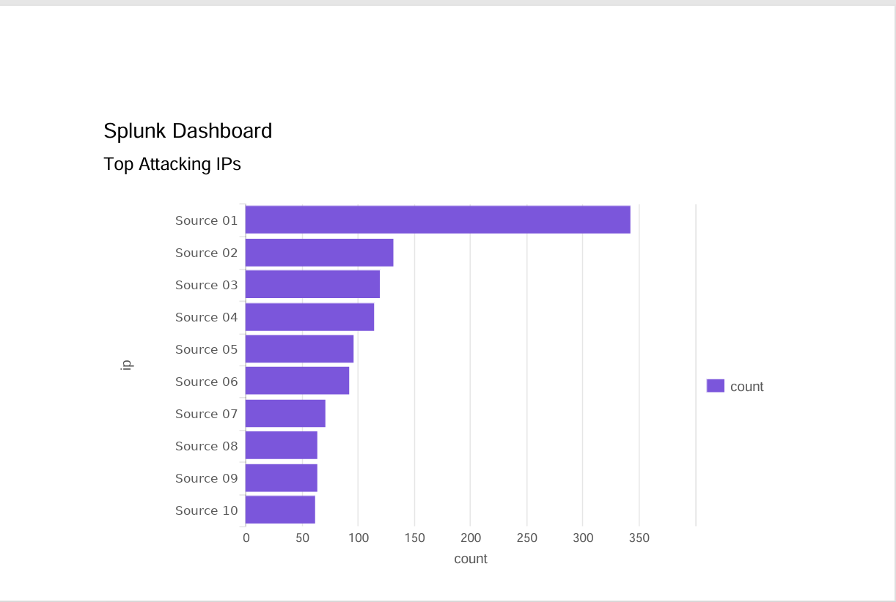
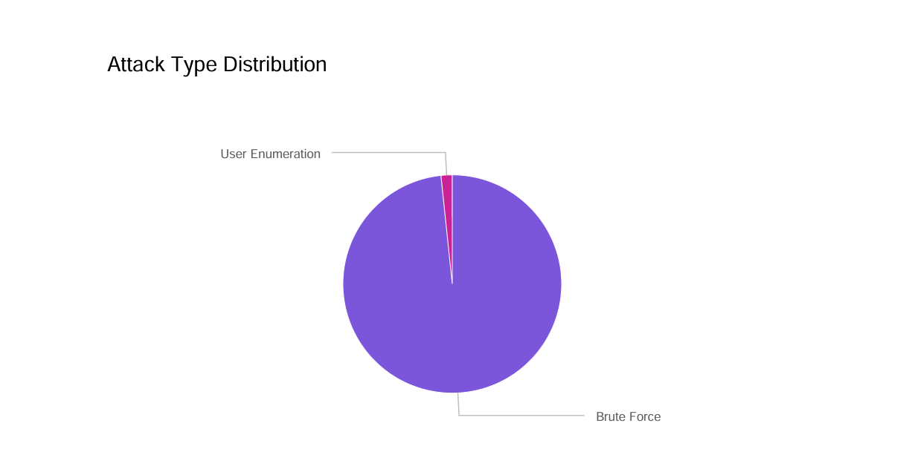
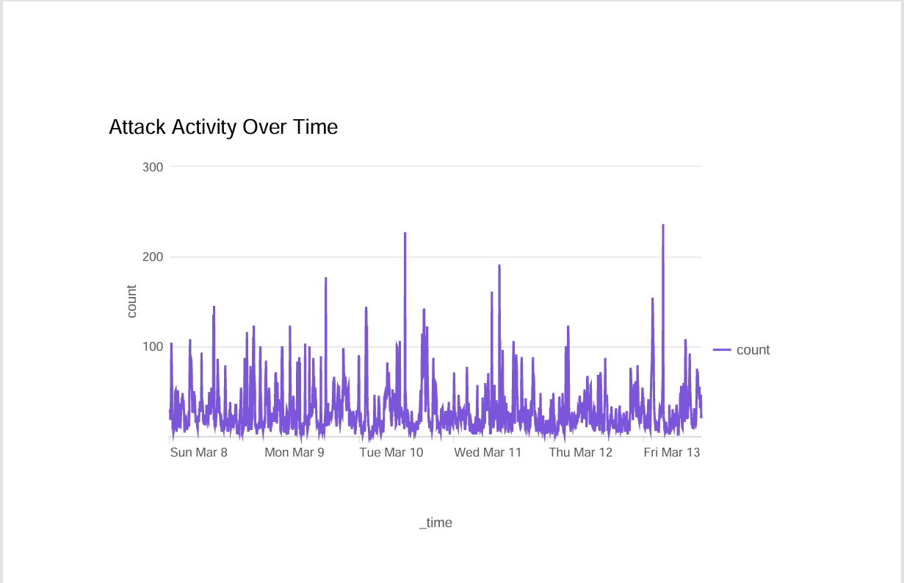
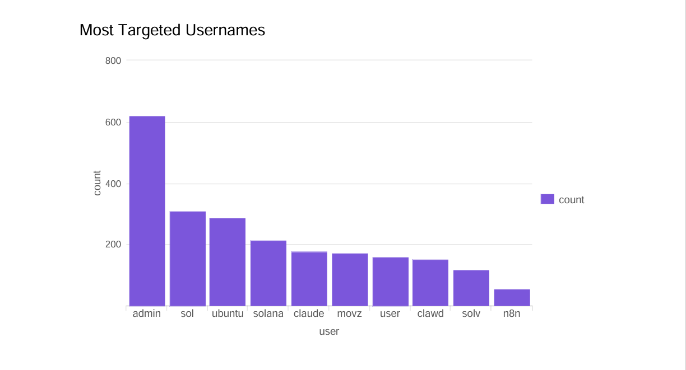

# SSH Monitoring Dashboard – Screenshot Gallery

This gallery presents four visualisations created in Splunk Enterprise for the SSH monitoring use case. The screenshots are portfolio examples from the analysed dataset.

## 1. Top Attacking Source Addresses

Source IP labels are replaced with generic identifiers (Source 01–10). The chart bars and event counts are retained.

## 2. Attack Type Distribution

Shows the distribution between the categories labelled Brute Force and User Enumeration in the original dashboard. These are classifications based on the dashboard's SPL logic, not independently confirmed attacker intent.

## 3. Attack Activity Over Time

Shows event volume over the displayed period (8–13 March 2026). Peaks indicate periods of increased logged activity and should be interpreted in the context of the selected time range and available telemetry.

## 4. Most Targeted Usernames

Ranks usernames appearing in the authentication events. Usernames remain visible in this portfolio version. Confirm that their publication is authorised before sharing the repository publicly.

## Privacy and interpretation

- Source IP labels are anonymised in the Top Attacking Source Addresses image.
- The other three screenshots do not display source IP addresses.
- Usernames remain visible in the Most Targeted Usernames chart.
- Counts are event counts from the analysed dataset; they should not be interpreted as unique attacker actions or proof of compromise.
